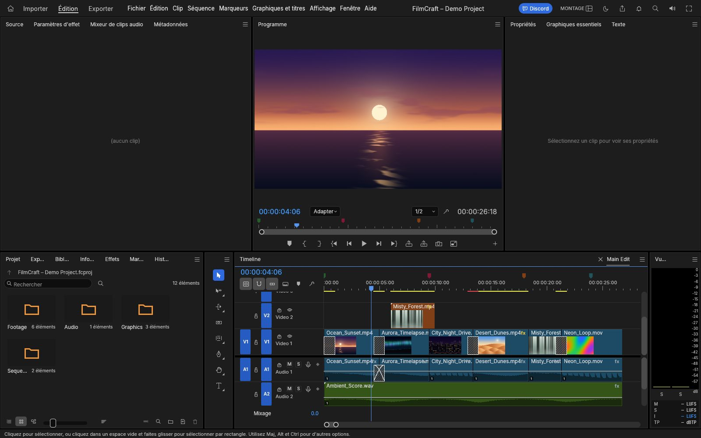

# FilmCraft Web

**Un éditeur vidéo non linéaire complet, directement dans le navigateur. Sans installation, sans compte, sans envoi de médias.**

### ▶ [**Jouer maintenant**](https://elzuzu.github.io/filmcraft-web-app/)

[](https://elzuzu.github.io/filmcraft-web-app/)

<p align="center"><sub>Le projet de démonstration : montage multi-pistes, moniteurs, vumètres et project bin. Tous les médias de cette capture sont générés par FilmCraft.</sub></p>

---

## Ce que vous pouvez faire

- **Monter** : timeline multi-pistes, montage en trois points, insert/overwrite, ripple, roll, slip, slide, rate stretch, rasoir, transitions, marqueurs, nests, multicam.
- **Étalonner** : correction primaire, roues chromatiques, courbes, HSL secondaire, vignette, scopes waveform/vectorscope calculés sur l'image gradée.
- **Animer** : position, échelle, rotation, opacité, plus de 90 effets et une trentaine de transitions, keyframes linéaires/Bezier/hold.
- **Son** : mixage, EQ, dynamique, limiteur true-peak, automation, vumètres ITU-R BS.1770 / EBU R128.
- **Titrer** : moteur de texte OpenType, titres, formes, tracés, sous-titres SRT/WebVTT/SCC.
- **Exporter** : H.264 MP4 + AAC, ProRes 422 HQ, DNxHR, GIF, WAV, séquences PNG, avec rendu en arrière-plan.

Le projet de démo s'ouvre au chargement. Vous pouvez importer vos propres fichiers par glisser-déposer ou avec **Importer**.

**Clip d'essai :** [`samples/ocean-sunset.mp4`](samples/ocean-sunset.mp4) (2 s, 640×360, généré par FilmCraft) — téléchargez-le puis glissez-le dans l'application.

## Configuration

| | |
|---|---|
| Navigateurs | Chrome / Edge récents (WebGPU), Firefox et Safari récents (WebGL2) |
| Rendu | WebGPU quand disponible, sinon WebGL2 ; `?webgl` force WebGL2, `?cpu` force le rendu CPU |
| Réseau | 100 % statique ; les médias restent sur votre machine et ne sont jamais téléversés |
| Poids | ~48 Mo de `.wasm` (≈15 Mo compressé), chargé une fois puis mis en cache |
| Compte | aucun |

Si le WebGPU de votre pilote pose problème, ouvrez la page avec
[`?webgl`](https://elzuzu.github.io/filmcraft-web-app/?webgl). Le son démarre après le
premier clic ou la première touche, comme l'exigent les navigateurs.

## Agents et automatisation

Chaque bouton, menu, glisser-déposer et raccourci est une **commande** du moteur.
La build web expose **716 commandes** via `window.filmcraft`, ce qui permet à un
agent de monter, étalonner, mixer et exporter exactement comme une personne.

```js
// Dans la console du navigateur
await filmcraft.execute('playhead.start');
await filmcraft.request('ui.playback', { action: 'play' });
const state = await filmcraft.inspect();
const shot = await filmcraft.screenshot({});
```

- [`AGENTS.md`](AGENTS.md) — référence de l'API `window.filmcraft`, modèle de temps, sélecteurs stables.
- [`agent/manifest.json`](agent/manifest.json) — descripteur lisible par machine (version, API, renderers, commandes).
- [`llms.txt`](llms.txt) — index pour les agents qui découvrent le site.

L'outillage **MCP + skill** complet (serveur stdio, CLI, skill portable, tests
d'intégration, scripts de build et de publication) est maintenu dans le dépôt
privé `filmcraft-agent`. Il n'est pas publié ici ; accès sur demande.

## Code source et licence

Ce dépôt est une **distribution compilée** : il ne contient pas le code source de
l'application. `filmcraft_web.js` est la colle générée par `wasm-bindgen`,
nécessaire pour charger le binaire ; ce n'est pas le code du projet.

- Le portage web, le packaging, le déploiement et l'outillage agent sont dans un
  dépôt privé.
- FilmCraft est un logiciel libre du projet **ArtCraft**, sous
  [MIT](LICENSE-MIT) **ou** [Apache-2.0](LICENSE-APACHE), au choix.
  Dépôt amont : <https://github.com/storytold/filmcraft>.
- Les notices tierces (polices OFL, composants MPL, etc.) sont dans
  [`NOTICE`](NOTICE) ; les crédits et licences des médias dans
  [`ATTRIBUTION.md`](ATTRIBUTION.md).

**Version :** FilmCraft `0.17.0` — commit amont `32749e34f611`, build web du
3 novembre 2026. Les empreintes des fichiers distribués sont dans
[`SHA256SUMS.txt`](SHA256SUMS.txt) :

```sh
sha256sum -c SHA256SUMS.txt
```

**Mise en ligne :** GitHub Pages sert la branche `main` à la racine. Voir
[`HOSTING.md`](HOSTING.md) pour un autre hébergeur (MIME `application/wasm`,
compression, cache).

## Crédits

FilmCraft est créé par l'équipe **ArtCraft** et ses contributeurs. Cette build web
est une distribution indépendante, **non affiliée et non endossée** par ArtCraft.
Les marques et logos ArtCraft ne sont pas utilisés dans ce dépôt. Les captures
montrent uniquement FilmCraft et des médias générés par FilmCraft.

